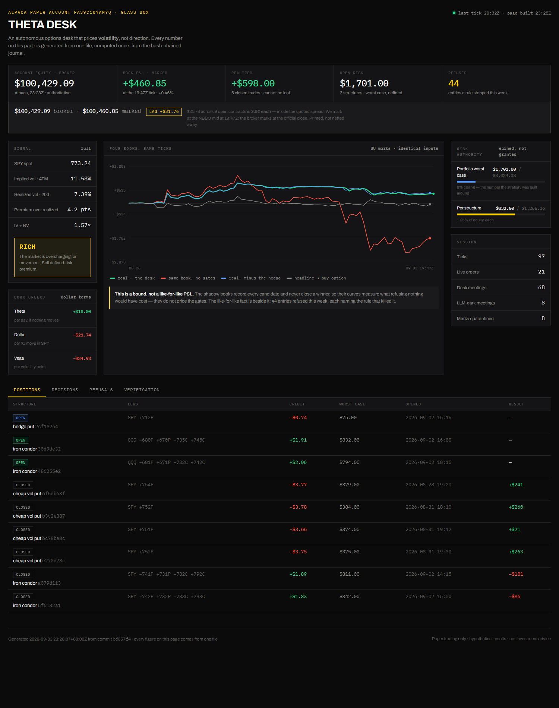
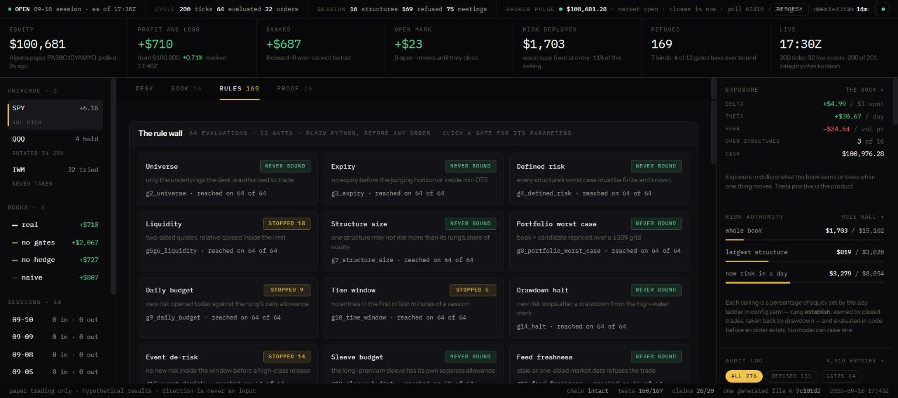
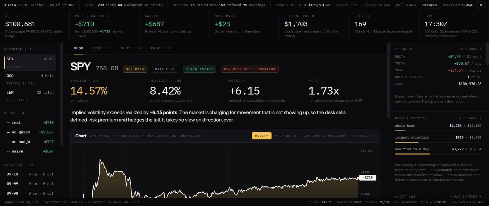
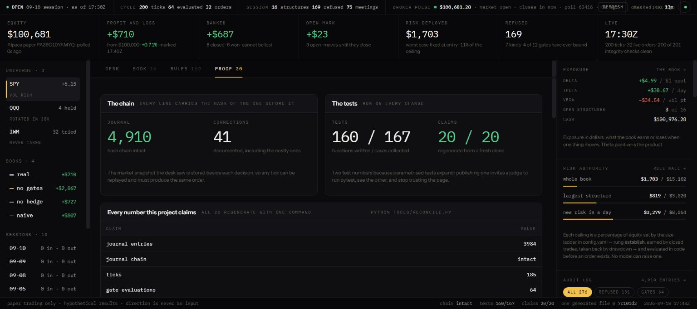

# Θ ThetaDesk
### Model-assisted research, deterministic permission to act.

A paper-trading options desk built for the Alpaca AI Trading Agents Hackathon. It combines volatility analysis, four model roles, portfolio-level risk checks and an auditable journal. **QwertyS · August–September 2026 · paper account only.**



*Archived September 3 dashboard snapshot. All balances, fills and P&L shown are hypothetical paper-trading results.*

[Official lablab submission](https://lablab.ai/ai-hackathons/alpaca-ai-trading-agents-hackathon/qwertys/theta-desk-autonomous-options-desk) ·
[Recorded hackathon demo](docs/portfolio/media/theta-desk-demo.mp4) ·
[Submitted deck](docs/portfolio/media/theta-desk-slides.pdf) ·
[Public source](https://github.com/pip00sya/theta-desk)

## A proposal is not an order

ThetaDesk separates the work of interpreting a possible trade from the rules that permit it. The model roles can disagree, veto or reduce a proposal. They cannot relax the deterministic constraints that run before an order is created.

The research signal compares implied volatility with recent realized volatility. The system explores defined-risk structures rather than asking a language model to predict the next price. The point of this case study is the decision architecture and its evidence—not a claim that the strategy produces durable investment returns.

## Four roles, one constrained decision path

| Role | Responsibility |
|---|---|
| Volatility analyst | Interpret the candidate and market context |
| Blind second opinion | Produce an independent view through another provider |
| News vetoer | Identify context that should block a candidate |
| Risk officer | Challenge the proposal and its assumptions |

Their output feeds a deterministic selection and validation path. Data-quality checks classify inputs before new risk is considered. Portfolio checks evaluate the current book together with the proposed structure; a candidate that breaches the allowed scenario loss is refused and that reason enters the journal.



*The rule wall makes gate activity inspectable: liquidity, budget, time windows and event exposure. This is a recorded paper-run export, not a live brokerage session.*

## Audit the things that did not happen

The desk records rejected candidates as well as completed activity. That is important because a system’s risk behaviour is largely expressed through refusal: liquidity, stale inputs, event windows, budgets and session boundaries can all prevent an otherwise plausible proposal from reaching execution.



*A later September 10 exported desk snapshot rendered locally. The status and financial figures belong to that archived paper run, not a live trading session.*

The dashboard compares the recorded desk with counterfactual books. Those curves use different assumptions and are labelled as a bound on behaviour, not a like-for-like attribution of profit to the gates. They are useful for inspecting decisions without turning a short competition run into a performance claim.

## Reproducibility is part of the product

~~~mermaid
flowchart LR
 A[Market snapshot] --> B[Quality gate]
 B --> C[Signal and candidate]
 C --> D[Model discussion]
 D --> E[Deterministic risk gates]
 E -->|Allowed| F[Paper broker]
 E -->|Refused| G[Decision journal]
 F --> H[Fill reconciliation]
 H --> G
 G --> I[Replay and dashboard]
~~~

A hash-chained journal makes in-place changes detectable. Input snapshots support signal replay; broker reconciliation distinguishes a proposed or pending order from an actual reported fill. A claims reconciler regenerates reported figures from the retained record.



*The Proof panel connects the journal, recorded checks and reproducible claims. Counts reflect the archived export; this screenshot is not a new test execution.*

The documented competition replay matched **91 of 91 signal snapshots**. That is a reproducibility check on the signal layer, not a validation of future market performance. The order path also has fake-broker tests, while the dashboard can render a committed export without access to live credentials.

## A useful failure changed the system

The development log records stale realized-volatility windows and unreliable after-hours marks. Those findings led to stronger data-quality handling and quarantined marks rather than silently rewriting the journal. The engineering lesson is that a correct formula applied to an unsuitable market snapshot is still a bad decision input.

**Stack:** Python, Alpaca paper execution and market data, model-provider adapters, deterministic gates, replay tools, a Streamlit interface and an exported web dashboard. Paper fills do not reproduce live-market execution costs or queue behaviour. No live-money operation is established by the project.


## Built for the Alpaca AI Trading Agents Hackathon

The online event ran **28 August–4 September 2026** on **lablab.ai**, with Alpaca's
paper-trading and market-data tools. ThetaDesk's official submission is titled
**THETA DESK — Autonomous Options Desk**, under team **Qwertys**; the capitalization
on the event platform differs from our portfolio name **QwertyS**.

The submission page connects the project to its source, Streamlit demo, presentation
and uploaded video. The included recording and deck preserve those competition
materials locally, so the project can be explored even if the hosted demo is asleep.
[Event and submission sources](docs/portfolio/HACKATHON.md) identify the dates and materials.
Participation is documented; this showcase does not assert a competition prize.

### Competition evidence and present-day checks

The recorded replay and dashboard counts belong to the archived competition run.
During the October migration, journal integrity was verified across **5,988 entries**.
The [engineering record](docs/portfolio/ENGINEERING-RECORD.md) distinguishes those archived
results from the later test run, including date-sensitive option-expiry fixtures.

## Run an offline desk before connecting providers

The archived desk can be explored without broker credentials:

```sh
pip install -e ".[dashboard,dev]"
python tools/demo_week.py
python tools/replay.py
python tools/reconcile.py
streamlit run dashboard/app.py
```

`demo_week.py` generates a separate simulated week. Replay and reconciliation
inspect retained inputs and claims; they do not submit broker orders.
The [development and competition record](DEVELOPMENT.md) covers the 19 rules,
model roles, scheduler and paper-only provider configuration.
[WRITEUP.md](WRITEUP.md), [DEVLOG.md](DEVLOG.md) and [API-FEEDBACK.md](API-FEEDBACK.md)
retain the original submission and its documented corrections.

Tests: `python -m pytest tests -q`. The retained options-expiry fixtures are
date-sensitive; [the verification record](docs/portfolio/ENGINEERING-RECORD.md)
reports the later run separately from competition-era test and replay counts.
The implementation is distributed under [MIT](LICENSE).


---

### QwertyS

Jointly developed by **[Nurkhan Aimukatov / pip00sya](https://github.com/pip00sya)** and
**[Shakhnazar Akhmer / Eye172](https://github.com/Eye172)**.
Both are Full-stack, Software and AI Engineers; Shakhnazar also works in ML engineering.
Our shared experience includes product design, application development, AI integration,
testing and preparing working hackathon submissions. We contributed as equal engineering
partners across the project.


This public implementation and project presentation are maintained on Nurkhan's account.
[Companion showcase on Shakhnazar's account](https://github.com/Eye172/thetadesk-showcase) ·
[Nurkhan's projects](https://github.com/pip00sya) · [Shakhnazar's projects](https://github.com/Eye172).

[Public original implementation](https://github.com/pip00sya/theta-desk) · [Eye172 history and data copy](https://github.com/Eye172/alpaca-ai-trading-agents-hackathon) (access depends on repository visibility).

[Hackathon record and supporting sources](docs/portfolio/HACKATHON.md) ·
[Media provenance](docs/portfolio/MEDIA.md).
